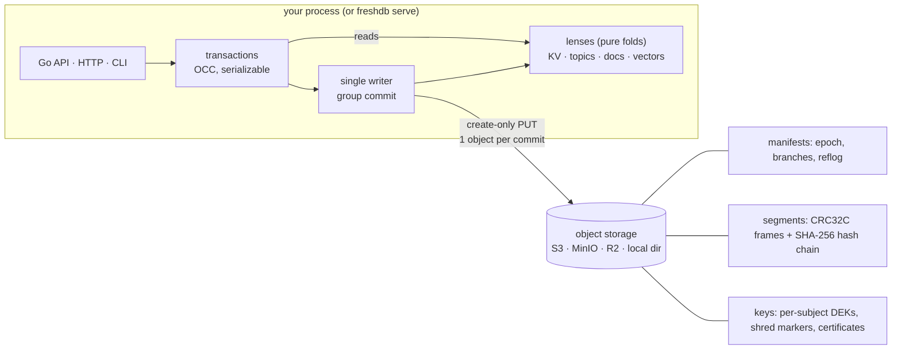

<p align="center">
  
</p>

<h3 align="center">One log. Every data model.</h3>

<p align="center">
KV, streams, documents, vectors and transactions as lenses over a single object-storage-native log,<br>
with branching, rewind and provable deletion. One Go binary. One URL.
</p>

<p align="center">
  <a href="https://github.com/raman20/freshdb/actions/workflows/ci.yml"></a>
  <a href="https://pkg.go.dev/github.com/raman20/freshdb"></a>
  <a href="https://goreportcard.com/report/github.com/raman20/freshdb"></a>
  <a href="https://github.com/raman20/freshdb/releases"></a>
  <a href="LICENSE"></a>
</p>

<p align="center">
  <a href="https://raman20.github.io/freshdb/">Website</a> ·
  <a href="#5-minute-quickstart">Quickstart</a> ·
  <a href="#api-tour">API tour</a> ·
  <a href="docs/architecture.md">Architecture</a> ·
  <a href="#correctness-evidence">Correctness</a> ·
  <a href="ROADMAP.md">Roadmap</a>
</p>

> [!WARNING]
> **Status: pre-1.0 prototype (v0.1.0). Do not use it in production.**
> The correctness core is model-checked and simulation-tested. Several things
> are still missing: compaction, disk-backed lenses, auth/TLS, KMS keys, and
> testing on AWS S3 or R2 (only MinIO is tested). The on-storage format may
> change before 1.0. See [Guarantees](#guarantees-and-non-guarantees) and
> [Limitations](#limitations).

---

## Why freshDB

A typical app or AI-agent backend today runs about six systems. There is
Postgres for state and Redis for cache and locks. Kafka or SQS carries events,
and a vector database holds memory. An outbox table keeps them consistent, and
scripts handle backups and "delete this user". Each one has its own failure
modes, its own backup story and its own deletion story.

In freshDB, **all of that is one append-only log** on object storage. The KV
store, topics, documents and vectors are not separate engines. They are
**lenses**: deterministic views folded from the same log. Because there is
only one log:

- **One transaction covers everything.** Consume a message, write the result
  and ack, all atomically. You don't need an outbox.
- **Branch, rewind and time travel are free.** A branch is "parent log + LSN",
  so no data is copied. You can undo a bad agent run or test a migration on a
  branch.
- **Deletion is provable.** `shred alice` destroys Alice's key, so her data
  becomes unreadable everywhere: every lens, every branch, every point in
  history. You get a signed certificate, and the log's hash chain still
  verifies.
- **Operations are simple.** One static Go binary (no CGO) and one URL
  (`./data` or `s3://bucket/prefix`). There is nothing else to run: no
  ZooKeeper, no Raft, no separate brokers.

freshDB does **not** try to be the fastest at any one of these jobs. It tries
to be *the simplest thing that is good enough* for small and medium apps and
agents. That is the same bet SQLite made. Read the
[design principles](docs/design-principles.md), including what we refuse to build.

## Install (30 seconds)

```sh
go install github.com/raman20/freshdb/cmd/freshdb@latest
freshdb version
```

Or download a binary from [Releases](https://github.com/raman20/freshdb/releases)
(Linux and macOS on amd64/arm64, Windows on amd64), or build from source:
`git clone https://github.com/raman20/freshdb && cd freshdb && go build ./cmd/freshdb`.

As a Go library: `go get github.com/raman20/freshdb`.

## 5-minute quickstart

Everything below is copy-paste. It uses a local directory (`./freshdb-data` by
default). The outputs are from a real run.

```console
$ freshdb put greeting "hello"
{"lsn":1}
$ freshdb put greeting "hello, world"
{"lsn":2}
$ freshdb get greeting
hello, world
$ freshdb get greeting --at 1                    # time travel
hello

$ freshdb pub events "signup: u17"               # topics + consumer groups
{"lsn":3}
$ freshdb pub events "signup: u18"
{"lsn":4}
$ freshdb sub events --group mailer --max 1
[{"lsn":3,"offset":0,"value":"signup: u17"}]

$ freshdb branch create exp                      # zero-copy branch
{"heads":{"exp":5,"main":5},"ok":true}
$ freshdb put greeting "experimental" --branch exp
{"lsn":6}
$ freshdb get greeting
hello, world
$ freshdb get greeting --branch exp
experimental

$ freshdb rewind main 1                          # undo: main back to LSN 1
{"heads":{"exp":6,"main":1},"ok":true}
$ freshdb get greeting
hello

$ freshdb put user/u17/email "alice@example.com" --subject alice
{"lsn":2}
$ freshdb shred alice                            # forget alice, provably
{
  "certificate": {
    "branch": "main",
    "chain_head": "2d4edd51e8c8f550b7df72370bf0ecfc02ea9b89e32029547bd2b9ceb5969315",
    "dek_deleted": true,
    "lenses_purged": [ "kv", "topic", "vector" ],
    …                                            (manifest id, public key, timestamp trimmed)
    "shred_lsn": 3,
    "signature": "13a55730fb96987b5c5747190073189b…",
    "subject_hash": "f60a506188e786cb4ecac2187a408666",
  },
  "valid_signature": true
}
$ freshdb get user/u17/email
error (404): freshdb: not found
$ freshdb verify                                 # CRCs, hash chains, fencing, shred proofs
{
  "chain_heads": {
    "exp": "6:9114c22c04dc6b20",
    "main": "3:2d4edd51e8c8f550"
  },
  "encrypted_values": 1,
  "entries": 8,
  "logs": 3,
  "manifests": 20,
  "ok": true,
  "segments": 38,
  "unreadable_shredded_values": 1
}
```

**Use S3 instead of a local directory.** Same commands, different URL:

```sh
export AWS_ACCESS_KEY_ID=… AWS_SECRET_ACCESS_KEY=…
export FRESHDB_URL='s3://my-bucket/app1?endpoint=127.0.0.1:9000&insecure=1&create=1'   # MinIO example
freshdb put hello world
```

**Run it as a server** (the CLI and server share one code path):

```sh
freshdb serve --db ./freshdb-data --listen 127.0.0.1:7070 &
export FRESHDB_ADDR=http://127.0.0.1:7070          # CLI now talks to the server
freshdb put k v
curl -s localhost:7070/v1/kv/k                     # v
```

> Opening a database takes the write lease and **fences every other writer**.
> When a server is running, point the CLI at it with `--addr` / `FRESHDB_ADDR`
> rather than opening the same URL directly.

## API tour

The same engine, used from Go. This is
[`examples/tour/main.go`](examples/tour/main.go), shortened; `go run ./examples/tour` prints the output shown.

```go
db, _ := freshdb.Open(ctx, "s3://bucket/app1?endpoint=...")   // or "./data", or "mem://x"

// KV
db.Put(ctx, "config/model", []byte("small"))

// Topics + consumer groups: result write and ack commit atomically (exactly-once)
db.Update(ctx, func(tx *freshdb.Tx) error {
    g := tx.Topic("tasks").Group("worker")
    msgs, _ := g.Fetch(1)
    tx.Put("result/0", []byte("3 unread, 1 urgent"))
    return g.Ack(msgs[0])
})

// Documents (+ an index added later, built by replaying the log) and vectors,
// tagged with a subject so they can be shredded
db.Update(ctx, func(tx *freshdb.Tx) error {
    tx.Doc("memories").Put("m1", map[string]any{"user": "alice", "text": "allergic to peanuts"}, freshdb.Subject("alice"))
    return tx.Vector("mem").Put("m1", []float32{0.9, 0.1, 0}, freshdb.Subject("alice"))
})
db.RegisterIndex(ctx, "memories", "user")
db.View(ctx, func(tx *freshdb.Tx) error {
    ids, _ := tx.Doc("memories").Find("user", "alice")
    hits, _ := tx.Vector("mem").Search([]float32{1, 0, 0}, 1)
    ...
})

// Time travel, branches, rewind
main := db.Branch("main")
good, _ := main.Head()
main.ViewAt(ctx, good, func(tx *freshdb.Tx) error { ... })
db.CreateBranch(ctx, "experiment", "main", good)
db.Rewind(ctx, "main", good)

// Forget
cert, _ := db.Shred(ctx, "alice")
report, _ := db.Verify(ctx)
```

```
kv: config/model = small
topic: worker got offset 0 "summarise inbox"
docs: memories where user=alice -> [m1]
vectors: nearest to [1 0 0] -> m1 (0.994)
time travel: at LSN 5 config/model = small
rewind: main config/model = small (old head kept in reflog)
branch: experiment config/model = medium
shred: certificate for LSN 6, DEK deleted=true, signed=true
after shred: docs(user=alice) -> [], nearest -> m2
after shred: new write for alice -> freshdb: subject has been crypto-shredded
verify: ok=true
```

**HTTP API** (JSON). Query parameters: `?branch=`, `?subject=` (writes) and
`?at=` (time travel).

| Endpoint | Purpose |
|---|---|
| `GET/PUT/DELETE /v1/kv/{key}`, `GET /v1/kv?prefix=` | KV |
| `POST /v1/tx` | atomic batch of `put`, `del`, `pub`, `ack`, `doc`, `vec` ops |
| `POST /v1/topics/{t}`, `GET /v1/topics/{t}?from=&max=`, `POST /v1/topics/{t}/groups/{g}/next` | topics, consumer groups |
| `PUT/GET /v1/docs/{c}/{id}`, `GET /v1/docs/{c}?field=&value=`, `POST /v1/indexes` | documents, secondary indexes |
| `PUT/DELETE /v1/vectors/{c}/{id}`, `POST /v1/vectors/{c}/search` | vectors |
| `GET/POST /v1/branches`, `POST /v1/branches/{b}/rewind`, `POST /v1/branches/{b}/promote` | branches |
| `GET /v1/log`, `POST /v1/shred/{subject}`, `GET /v1/verify` | raw log, forget, audit |

Errors: `404` not found, `409` conflict (retry), `410` subject shredded, `503` fenced by a newer writer.

## Demo: an agent with undo, memory and forget

[`examples/agent-demo.sh`](examples/agent-demo.sh) starts a server and walks an
AI agent through five scenes:

1. Remember things about Alice (KV + doc + vector).
2. Process tasks exactly-once.
3. Go rogue, then get undone with time travel and rewind.
4. Try a plan on a branch and promote it.
5. Forget Alice when she asks.

```sh
go build -o /tmp/freshdb ./cmd/freshdb && FRESHDB=/tmp/freshdb ./examples/agent-demo.sh   # needs jq, curl
```

The last two scenes, from [a real run](examples/agent-demo.out):

```
== 5. Forget: alice invokes her right to erasure — crypto-shred subject 'alice'
{"valid_signature":true,"shred_lsn":12,"dek_deleted":true,"chain_head":"77c5cfcca30ba82a...","signature":"64584b31c2ac216c..."}
-- KV:
error (404): freshdb: not found
-- time travel:
error (404): freshdb: not found
-- old branch:
error (404): freshdb: not found
-- docs about alice:
[]
-- vector recall [1,0,0]:
{"id":"m2","score":0.11043153}
-- task t1 in the topic (offsets stay stable, content is gone):
{"lsn":6,"offset":0,"redacted":true,"value":""}
-- bob is untouched: {"user":"bob","text":"bob prefers window seats"}
-- new writes for alice are refused:
error (410): freshdb: subject has been crypto-shredded

== 6. Verify the whole history (CRCs, hash chains, fencing, shred proofs)
{"ok":true,"logs":3,"segments":17,"entries":14,"encrypted_values":8,"unreadable_shredded_values":6,"problems":null}
-- grep every byte in the bucket for anything about alice:
no trace of 'alice', 'peanuts', 'oat milk' or 'ESPRESSO' in /tmp/agent-demo-data
```

## How it works



- **Writes.** Transactions are validated optimistically (OCC) by the single
  writer, then group-committed as one immutable segment object with a
  create-only PUT. A write is acked only after that PUT succeeds.
- **Fencing without clocks.** `Open` creates the next manifest with
  `epoch+1`. Because manifests are create-only, exactly one opener wins. A
  zombie writer's next create-only write collides, or it sees the newer
  epoch, and it stops with `ErrFenced`.
- **Lenses** are pure folds over `redact(log, shredded)`. A test enforces that
  they import nothing that could observe the outside world.
- **Branches** are a parent log plus a fork LSN. Rewind forks a new log and
  keeps the old head in a reflog.
- **Shred** deletes the subject's data key. Ciphertext stays in place, so the
  hash chain still verifies.

Read more in [docs/architecture.md](docs/architecture.md) and
[docs/formats.md](docs/formats.md).

## Guarantees and non-guarantees

**What freshDB guarantees** (within the tested scope below):

| | Guarantee |
|---|---|
| Durability | A transaction is acknowledged only after its segment is durable: S3 PUT returned success, or a local file was fsync'd and atomically linked. Acked transactions survive crashes and restarts. |
| Atomicity | A transaction's ops all appear or none do, across every lens. |
| Isolation | Transactions on a branch are **serializable**. There is a single writer per database with OCC read-set validation on KV, topic and cursor reads. |
| Exactly-once processing | Fetch + write + ack in one transaction processes each message at most once, and each ack is atomic with its writes. |
| Fencing | After a newer `Open` succeeds, an older writer can never commit again. |
| Recoverability | Damage below the tail is reported (`ErrCorrupt`), never silently dropped. A torn final segment is repaired to its valid prefix, and the original is kept in `quarantine/`. |
| Lens consistency | For every lens, `state == fold(redact(log, shredded))`, including after restart, snapshots, branches and rewinds. |
| History | Time travel to any LSN returns exactly what was visible then, minus shredded data. Rewind never deletes the old head; it goes into the reflog. |
| Shred | After `Shred(s)` returns, freshDB returns no value written with subject `s` on any branch, at any LSN. The subject's DEK is deleted, new writes for `s` are refused (`410`), and the hash chain and signed certificate verify. |

**What freshDB does *not* guarantee** (yet, or by design):

- **No shred for metadata.** Keys, topic names, collection names, and values
  written *without* a subject are stored in plaintext and are not affected by
  shred. Put personal data in subject-tagged values, and use opaque ids in keys.
- **Backups and versioned buckets can defeat shred.** If a backup or an old
  object version still holds the DEK, the data can be decrypted from it. In dev
  mode the KEK also lives in the bucket. See [SECURITY.md](SECURITY.md).
- **Not every read is serializable.** Vector-search and doc-index reads are not
  part of OCC validation. A transaction that searches and then writes is not
  serializable with respect to the search.
- **HTTP `groups/{g}/next` is at-most-once for the client.** It fetches and
  acks in one call. For exactly-once, put the result write and the ack in the
  same `/v1/tx` or Go transaction.
- **No high availability.** There is one writer per database, and a failed
  writer means downtime until something calls `Open` again.
- **Power loss is not modelled by the crash test.** It uses kill -9; torn
  writes are injected separately, by the simulator.

## Correctness evidence

Results are from this repo at v0.1.0. CI reruns the TLC checks, 2,000
simulator seeds, fuzzing and the MinIO tests on every push.

| Method | What | Result |
|---|---|---|
| **TLA+ / TLC** ([spec/](spec), [results](spec/RESULTS.md)) | FreshLog (fencing, recovery, torn tails, lost/duplicated PUTs) | 10,415,103 states (2,475,220 distinct), no error |
| | FreshTxn (serializable OCC, exactly-once consume+ack) | 21,685,744 states (2,421,454 distinct), no error |
| | FreshBranch (branch, rewind, time travel) | 3,430,206 states (1,845,287 distinct), no error |
| | FreshShred (shred steps, crashes, late DEKs; incl. liveness) | 25,570 states (6,481 distinct), no error |
| **Deterministic simulation** ([sim/](sim)) | seeded workload + fault-injecting store; checks against a reference model after every step | 50,000 seeds before the final fixes and 10,000 on the final code, all OK. The 10k run covered 137,293 acked txns, 75,537 crashes, 29,979 writer takeovers and 114,926 injected faults. |
| **Property tests** ([rapid](https://pgregory.net/rapid)) | `lens == fold(log)`, snapshot+tail == fold, `DropSubject == fold(redacted)`, lenses refine reference models | 5,000 checks per lens property, 500 engine programs |
| **Crash test** | 4 concurrent writers, kill -9 at random points | 200 rounds, 20,166 recovered txns, all checks OK |
| **Fuzzing** | segment + payload decoders | ~3 min total, clean after fixing one finding |

**Bugs these tools found** (all fixed and covered by regression tests):

- **TLC** found that a slow opener could write an older-epoch fence after a
  newer one. That would brick the log on the next open.
- **Fuzzing** found that the payload decoder accepted non-canonical varints.
- **Property tests** found a vector lens state that wasn't canonical after a
  shred.
- **The simulator** found a DEK that landed late, after a shred.

Details are in [spec/RESULTS.md](spec/RESULTS.md) and [CHANGELOG.md](CHANGELOG.md).

Reproduce:

```sh
go test -race ./...                                   # everything (500 sim seeds)
go test ./sim -run TestSimulation -seeds=10000        # more seeds; -seed=N replays one
go test -run '^$' -fuzz '^FuzzDecodePayload$' -fuzztime 60s ./format
JAVA=java TLA_JAR=/path/to/tla2tools.jar spec/run_tlc.sh
```

What the evidence does **not** show: the specs are bounded and matched to the
code by hand, so nothing is proven equivalent to the code. The simulator does
not interleave two concurrent `Open`s; TLC and a dedicated test cover that case.

## How it compares

This is a fair-minded summary based on the design research behind freshDB,
as of October 2026. Each project here is excellent at its main job, and most are far
more mature than freshDB. Corrections are welcome.

| | Main job | Object-storage native | Branching / time travel | Topics + KV + docs + vectors in one txn | Per-subject provable deletion | Deployment |
|---|---|---|---|---|---|---|
| **freshDB** | simple multi-model log for apps and agents | yes (single writer, create-only fencing) | branches, rewind, time travel | yes | crypto-shred with signed certificate | Go library or one binary; **prototype** |
| **SlateDB** | embedded LSM KV on object storage | yes (single writer, epoch fencing) | writable clones from checkpoints | KV only | no | Rust library; Go bindings need CGO |
| **Kafka / Redpanda** | distributed event streaming | Redpanda: tiered storage and Iceberg topics | log offsets; not branches | topics only (KV via compaction) | compaction tombstones / app-level | broker cluster |
| **Postgres + pgvector** | general-purpose SQL, "good enough" at JSON, queues and vectors | no (Neon adds it as a separate service) | via Neon branches | yes, in SQL | app-level deletes | server |
| **Redis** | in-memory data structures | no | no | in-memory data structures (Redis Stack bundles extra modules) | app-level deletes | server, memory-first |
| **SQLite** | embedded SQL, single file | no (Litestream replicates to S3) | no | SQL; vectors via sqlite-vec | app-level deletes | library |
| **XTDB** | immutable bitemporal SQL | — | bitemporal queries | SQL | `ERASE` (physically removes history) | server |
| **Dolt** | Git-style versioned SQL | no | branch, merge, diff | SQL | no | server / binary |

**When not to use freshDB:**
- You need high write throughput on a single dataset.
- You need multi-writer or high availability today.
- Your dataset doesn't fit in RAM.
- You need ad-hoc SQL.
- You need production maturity.

For those, use the systems above.

## Benchmarks

> **One run on a shared 8-vCPU VM, embedded Go engines, S3 = local MinIO.
> This is not a performance claim.** The full tables, method, commands and
> caveats are in [docs/benchmarks.md](docs/benchmarks.md); the raw JSON is in
> [bench/results](bench/results/2026-10-27/).

YCSB, 1M × 1 KiB records, zipfian, fsync on. Throughput is closed-loop
successful ops/s:

| | freshDB | Badger | Pebble | bbolt | SQLite |
|---|---:|---:|---:|---:|---:|
| C (read-only), 8 clients | **2.82M** | 261k | 197k | 752k | 37k |
| B (95% read), 64 clients | **697k** | 159k | 194k | 242k | 34k |
| A (50% update), 1 client | 3.7k | 19k | **32k** | 22k | 9.3k |
| A (50% update), 64 clients | 81k | 25k | **119k** | 24k | 13k |
| F (read-modify-write), 64 clients | 67k ¹ | 28k ¹ | **81k** | 22k | 8.9k |
| Peak RSS | 7.1 GiB | 3.5 GiB | **0.7 GiB** | 1.7 GiB | 0.3 GiB |

¹ Plus RMWs that gave up after 16 OCC conflict retries: 9,660 for freshDB
and 1,045 for Badger.

**Where freshDB loses:**
- Single-client durable writes (each commit does its own fsyncs).
- Hot-key contention (OCC aborts instead of queueing).
- Memory (lens state lives in RAM).
- Low-rate streaming tail latency: e2e p99 at 1k msgs/s is 23 ms, vs 1.9 ms
  for NATS JetStream.
- Vector search: exact only, 19 QPS at 100k × 128-d, vs 145 for a plain Go
  loop.

**Where it is strong:**
- Reads.
- Many concurrent writers through group commit.
- Durable streaming throughput: 42k msgs/s, vs 8.5k for NATS with
  `SyncAlways`.
- Exactly-once consume→write→publish transactions: 62k msgs/s, and the check
  passes in every run.

On S3, a commit costs 1 PUT at 1 writer, ≈ $5 per 1M commits at AWS list
price (*estimate*). It costs 0.03 PUTs at 64 writers thanks to group commit.

Reproduce with `cd bench && scripts/run-all.sh`. Engine micro-benchmarks are
still available with `go test -run '^$' -bench . -benchmem .`.

## Deployment notes

- **URL forms.**
  - `./dir` or `file:///abs/path`: local directory.
  - `s3://bucket/prefix?endpoint=host:port&insecure=1&create=1`: any
    S3-compatible store. `insecure` means plain HTTP and `create` creates the
    bucket.
  - `mem://name`: in-memory, for tests.
  - Credentials are read from `AWS_ACCESS_KEY_ID` / `AWS_SECRET_ACCESS_KEY`.
- **Object stores.**
  - The store must support create-only conditional writes (`If-None-Match: *`).
  - **MinIO is tested in CI.**
  - AWS S3 and Cloudflare R2
    ([docs](https://developers.cloudflare.com/r2/reference/consistency/))
    document this support but are **not tested yet**.
- **Single writer.** Run one writer per database. Shard by database (for
  example one per tenant or agent) to scale. Don't point two servers at the
  same URL: the newer one fences the older one, which is safe but not useful.
- **Backup.** Copying the bucket prefix is a complete backup. Objects are
  immutable, except that `keys/dek/*` are deleted on shred. A backup made
  before a shred can still decrypt that subject. Expire noncurrent versions of
  `keys/` if you rely on shred.
- **Growth.** There is no compaction yet. Object count grows by one per group
  commit, plus a manifest and a fence for every open, and every CLI call in
  embedded mode is an open. Prefer `freshdb serve` for long-running use.
- **Memory.** All lens state lives in RAM.

## Security

Please report vulnerabilities privately; see [SECURITY.md](SECURITY.md). Short version:

- The HTTP server has **no auth or TLS**. It binds to `127.0.0.1` by default.
- In dev mode, the KEK and the signing key are stored in the bucket. The Go
  API accepts `WithKEK`.
- Only subject-tagged values are encrypted.

## Limitations

- All lens state is in RAM. There is no compaction. Snapshots are off by
  default: they are written synchronously in the commit path and don't speed
  up open yet.
- Vector search is exact brute force; there is no ANN index.
- There is one writer per database, with no HA and no replicas.
- In-flight commits that race a `rewind` land on the retired log. That log
  stays reachable via the reflog.
- A DEK create that lands after a shred leaves an orphan key until the next
  open or `verify` sweeps it. No plaintext is served in that window.
- The CLI has no `--kek` flag yet.
- The on-storage format may change before 1.0.

## Project

- [ROADMAP.md](ROADMAP.md): what's next, including good first issues
- [CONTRIBUTING.md](CONTRIBUTING.md): dev setup and the correctness bar for changes
- [docs/](docs): [architecture](docs/architecture.md), [formats](docs/formats.md), [lens authoring](docs/lens-authoring.md), [design principles](docs/design-principles.md), [FAQ](docs/faq.md)
- [CHANGELOG.md](CHANGELOG.md) · [GOVERNANCE.md](GOVERNANCE.md) · [CODE_OF_CONDUCT.md](CODE_OF_CONDUCT.md) · [SECURITY.md](SECURITY.md)

```
*.go         engine: open/fencing, writer + group commit, transactions, branches, shred/verify, keyring
format/      segment + payload encoding (CRC32C, hash chain), fuzz targets
lens/        pure folds: KV (MVCC), topics, docs + indexes, vectors; property tests
store/       Store interface: fs, s3, mem, faulty (fault injection)
sim/         deterministic simulator
server/      HTTP API          cmd/freshdb/  the single binary
spec/        TLA+ specs + TLC results          examples/  agent demo, API tour
```

*History: freshDB began as a rewrite of an earlier prototype called goli.*

## License

Apache License 2.0. See [LICENSE](LICENSE).
