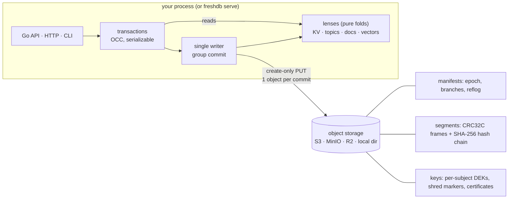

<p align="center">
  
</p>

<h3 align="center">One log. One binary. One API.</h3>

<p align="center">
KV, streams, documents, vectors and transactions as lenses over a single append-only log<br>
on object storage or a local disk, with branching, rewind and provable deletion.
</p>

<p align="center">
  <a href="https://github.com/raman20/freshdb/actions/workflows/ci.yml"></a>
  <a href="https://pkg.go.dev/github.com/raman20/freshdb"></a>
  <a href="https://goreportcard.com/report/github.com/raman20/freshdb"></a>
  <a href="https://github.com/raman20/freshdb/releases"></a>
  <a href="LICENSE"></a>
</p>

<p align="center">
  <a href="https://raman20.github.io/freshdb/">Website</a> ·
  <a href="docs/index.md">Docs</a> ·
  <a href="#5-minute-quickstart">Quickstart</a> ·
  <a href="#api-tour">API tour</a> ·
  <a href="#benchmarks">Benchmarks</a> ·
  <a href="#status-and-limitations">Status</a> ·
  <a href="ROADMAP.md">Roadmap</a>
</p>

> [!WARNING]
> **Status: pre-1.0 prototype. Do not use it in production.** The latest
> release is v0.1.0; `main` has unreleased changes (journal storage by
> default, values read from the log, faster vectors, no OCC give-ups, and a
> first version of compaction). The correctness core is model-checked and
> simulation-tested. Still missing: larger-than-RAM lens state, built-in KMS clients, and testing on
> AWS S3 or R2 (only MinIO is tested). The on-storage format may change
> before 1.0. See [Status and limitations](#status-and-limitations).

---

## Why freshDB

A typical app or AI-agent backend today runs about six systems. There is
Postgres for state and Redis for cache and locks. Kafka or SQS carries events,
and a vector database holds memory. An outbox table keeps them consistent, and
scripts handle backups and "delete this user". Each one has its own failure
modes, its own backup story and its own deletion story.

In freshDB, **all of that is one append-only log**. The KV store, topics,
documents and vectors are not separate engines. They are **lenses**:
deterministic views folded from the same log. Because there is only one log:

- **One transaction covers everything.** Consume a message, write the result
  and ack, all atomically. You don't need an outbox.
- **Branch, rewind and time travel are free.** A branch is "parent log + LSN",
  so no data is copied. You can undo a bad agent run or test a migration on a
  branch.
- **Deletion is provable.** `shred alice` destroys Alice's key, so her data
  becomes unreadable everywhere: every lens, every branch, every point in
  history. You get a signed certificate, and the log's hash chain still
  verifies.
- **Operations are simple.** One static Go binary (no CGO) and one URL
  (`./data` or `s3://bucket/prefix`). There is nothing else to run: no
  ZooKeeper, no Raft, no separate brokers.

freshDB does **not** try to be the fastest at any one of these jobs. It tries
to be *the simplest thing that is good enough* for small and medium apps and
agents. That is the same bet SQLite made. Read the
[design principles](docs/design-principles.md), including what we refuse to build.

## Features

| | What you get | Notes |
|---|---|---|
| **KV** | get/put/delete, prefix scan, MVCC history | values over 64 B are read from the log through an off-heap cache (`WithValueCacheBytes`, default 256 MiB) |
| **Topics** | publish, consumer groups, exactly-once consume+write+ack; push via `WaitHead`, HTTP long-poll (`?wait=`) and SSE | no topic retention; no limit on concurrent waiters/streams |
| **Documents** | JSON documents, secondary indexes added at any time (built by replaying the log) | equality lookups only |
| **Vectors** | cosine search, exact (recall 1.0, parallel scan) or opt-in HNSW (`vec ann`) | the HNSW graph is in RAM; saved on close and reloaded on open (10 s at 1M), recall@10 0.92 at 1M with the default ef |
| **Transactions** | serializable OCC across all lenses; hot keys cannot starve | single writer per database |
| **History** | time travel to any LSN, zero-copy branches, rewind, promote, reflog | after `compact`, history below each branch head is gone (`410`); `gc` keeps a window |
| **Compaction / GC** | `freshdb compact` drops overwritten, deleted and shredded data; `freshdb gc --keep-for 24h` keeps a history window and also deletes old manifests, retired logs and pruned reflog; `--shrink` rewrites the journal file | new on `main`; commits pause while it runs; shrink is offline; no topic retention |
| **Deletion** | per-subject crypto-shred, signed certificate, `verify` | covers subject-tagged values only |
| **Storage** | local directory (journal layout on Linux/macOS/BSD), S3-compatible stores, in-memory | only MinIO is tested among object stores |
| **Interfaces** | Go library, JSON/HTTP server, CLI — one binary | `serve` has bearer tokens scoped read/write/admin (optionally per collection), reloaded without restart, and optional TLS with cert reload |

## Install

The latest release is **v0.1.0**. Everything this README describes (journal
default, `freshdb migrate`, the new numbers) is on unreleased `main`, so
install from `main` or build from source:

```sh
go install github.com/raman20/freshdb/cmd/freshdb@main     # Go 1.27+
freshdb version
```

Or build from source:
`git clone https://github.com/raman20/freshdb && cd freshdb && go build ./cmd/freshdb`.

v0.1.0 binaries (Linux and macOS on amd64/arm64, Windows on amd64) are on
[Releases](https://github.com/raman20/freshdb/releases); `@latest` also
resolves to v0.1.0. As a Go library: `go get github.com/raman20/freshdb@main`.

## 5-minute quickstart

Everything below is copy-paste. It uses a local directory (`./freshdb-data` by
default; on Linux/macOS a new directory gets the one-file journal layout).
The outputs are from a real run of `main`.

```console
$ freshdb put greeting "hello"
{"lsn":1}
$ freshdb put greeting "hello, world"
{"lsn":2}
$ freshdb get greeting
hello, world
$ freshdb get greeting --at 1                    # time travel
hello

$ freshdb pub events "signup: u17"               # topics + consumer groups
{"lsn":3}
$ freshdb pub events "signup: u18"
{"lsn":4}
$ freshdb sub events --group mailer --max 1
[{"lsn":3,"offset":0,"value":"signup: u17"}]

$ freshdb branch create exp                      # zero-copy branch
{"heads":{"exp":5,"main":5},"ok":true}
$ freshdb put greeting "experimental" --branch exp
{"lsn":6}
$ freshdb get greeting
hello, world
$ freshdb get greeting --branch exp
experimental

$ freshdb rewind main 1                          # undo: main back to LSN 1
{"heads":{"exp":6,"main":1},"ok":true}
$ freshdb get greeting
hello

$ freshdb put user/u17/email "alice@example.com" --subject alice
{"lsn":2}
$ freshdb shred alice                            # forget alice, provably
{
  "certificate": {
    "branch": "main",
    "chain_head": "54fc01cc560a412220302230adce4476bb189af4214ad8ad15520ab9e78de356",
    "dek_deleted": true,
    "lenses_purged": [ "kv", "topic", "vector" ],
    …                                            (manifest id, public key, timestamp trimmed)
    "shred_lsn": 3,
    "signature": "c38cd13433e48e56e3f011203a9b3d3f…",
    "subject_hash": "f60a506188e786cb4ecac2187a408666",
  },
  "valid_signature": true
}
$ freshdb get user/u17/email
error (404): freshdb: not found
$ freshdb verify                                 # CRCs, hash chains, fencing, shred proofs
{
  "chain_heads": {
    "exp": "6:e5e12e0b9a56ad8e",
    "main": "3:54fc01cc560a4122"
  },
  "encrypted_values": 1,
  "entries": 8,
  "logs": 3,
  "manifests": 19,
  "ok": true,
  "segments": 36,
  "unreadable_shredded_values": 1
}
```

Hashes and signatures differ on every run.

**Use S3 instead of a local directory.** Same commands, different URL:

```sh
export AWS_ACCESS_KEY_ID=… AWS_SECRET_ACCESS_KEY=…
export FRESHDB_URL='s3://my-bucket/app1?endpoint=127.0.0.1:9000&insecure=1&create=1'   # MinIO example
freshdb put hello world
```

**Run it as a server** (the CLI and server share one code path):

```sh
freshdb serve --db ./freshdb-data --listen 127.0.0.1:7070 &
export FRESHDB_ADDR=http://127.0.0.1:7070          # CLI now talks to the server
freshdb put k v
curl -s localhost:7070/v1/kv/k                     # v
```

> Opening a database takes the write lease and **fences every other writer**.
> When a server is running, point the CLI at it with `--addr` / `FRESHDB_ADDR`
> rather than opening the same URL directly.

More: [docs/getting-started.md](docs/getting-started.md) (documents, vectors,
transactions from the CLI) and [docs/operations.md](docs/operations.md)
(storage URLs, migration, cache sizing, backups).

## API tour

The same engine, used from Go. This is
[`examples/tour/main.go`](examples/tour/main.go), shortened; `go run ./examples/tour` prints the output shown.

```go
db, _ := freshdb.Open(ctx, "s3://bucket/app1?endpoint=...")   // or "./data", or "mem://x"

// KV
db.Put(ctx, "config/model", []byte("small"))

// Topics + consumer groups: result write and ack commit atomically (exactly-once)
db.Update(ctx, func(tx *freshdb.Tx) error {
    g := tx.Topic("tasks").Group("worker")
    msgs, _ := g.Fetch(1)
    tx.Put("result/0", []byte("3 unread, 1 urgent"))
    return g.Ack(msgs[0])
})

// Documents (+ an index added later, built by replaying the log) and vectors,
// tagged with a subject so they can be shredded
db.Update(ctx, func(tx *freshdb.Tx) error {
    tx.Doc("memories").Put("m1", map[string]any{"user": "alice", "text": "allergic to peanuts"}, freshdb.Subject("alice"))
    return tx.Vector("mem").Put("m1", []float32{0.9, 0.1, 0}, freshdb.Subject("alice"))
})
db.RegisterIndex(ctx, "memories", "user")
db.View(ctx, func(tx *freshdb.Tx) error {
    ids, _ := tx.Doc("memories").Find("user", "alice")
    hits, _ := tx.Vector("mem").Search([]float32{1, 0, 0}, 1)
    ...
})

// Time travel, branches, rewind
main := db.Branch("main")
good, _ := main.Head()
main.ViewAt(ctx, good, func(tx *freshdb.Tx) error { ... })
db.CreateBranch(ctx, "experiment", "main", good)
db.Rewind(ctx, "main", good)

// Forget
cert, _ := db.Shred(ctx, "alice")
report, _ := db.Verify(ctx)
```

```
kv: config/model = small
topic: worker got offset 0 "summarise inbox"
docs: memories where user=alice -> [m1]
vectors: nearest to [1 0 0] -> m1 (0.994)
time travel: at LSN 5 config/model = small
rewind: main config/model = small (old head kept in reflog)
branch: experiment config/model = medium
shred: certificate for LSN 6, DEK deleted=true, signed=true
after shred: docs(user=alice) -> [], nearest -> m2
after shred: new write for alice -> freshdb: subject has been crypto-shredded
verify: ok=true
```

**HTTP API** (JSON). Query parameters: `?branch=`, `?subject=` (writes) and
`?at=` (time travel).

| Endpoint | Purpose |
|---|---|
| `GET/PUT/DELETE /v1/kv/{key}`, `GET /v1/kv?prefix=` | KV |
| `POST /v1/tx` | atomic batch of `put`, `del`, `pub`, `ack`, `doc`, `vec` ops |
| `POST /v1/topics/{t}`, `GET /v1/topics/{t}?from=&max=&wait=30s`, `POST /v1/topics/{t}/groups/{g}/next?wait=30s` | topics, consumer groups (`wait`: long-poll, max 60 s) |
| `GET /v1/topics/{t}/stream?from=` | Server-Sent Events: one `message` event per message, `id` = offset, resumes from `Last-Event-ID` |
| `GET /healthz` | liveness; never needs the token |
| `PUT/GET /v1/docs/{c}/{id}`, `GET /v1/docs/{c}?field=&value=`, `POST /v1/indexes` | documents, secondary indexes |
| `PUT/DELETE /v1/vectors/{c}/{id}`, `POST /v1/vectors/{c}/search` | vectors |
| `GET/POST /v1/branches`, `DELETE /v1/branches/{b}`, `POST /v1/branches/{b}/rewind`, `POST /v1/branches/{b}/promote` | branches |
| `GET /v1/log`, `POST /v1/shred/{subject}`, `GET /v1/verify` | raw log, forget, audit |
| `POST /v1/compact?grace=5m`, `POST /v1/gc?keep-for=24h` | compaction, GC (see [operations](docs/operations.md#gc-and-retention)) |

Errors: `404` not found, `409` conflict (retry), `410` subject shredded or history compacted away, `503` fenced by a newer writer.

## Demo: an agent with undo, memory and forget

[`examples/agent-demo.sh`](examples/agent-demo.sh) starts a server and walks an
AI agent through five scenes:

1. Remember things about Alice (KV + doc + vector).
2. Process tasks exactly-once.
3. Go rogue, then get undone with time travel and rewind.
4. Try a plan on a branch and promote it.
5. Forget Alice when she asks.

```sh
go build -o /tmp/freshdb ./cmd/freshdb && FRESHDB=/tmp/freshdb ./examples/agent-demo.sh   # needs jq, curl
```

The last two scenes, from [a real run](examples/agent-demo.out):

```
== 5. Forget: alice invokes her right to erasure — crypto-shred subject 'alice'
{"valid_signature":true,"shred_lsn":12,"dek_deleted":true,"chain_head":"77c5cfcca30ba82a...","signature":"64584b31c2ac216c..."}
-- KV:
error (404): freshdb: not found
-- time travel:
error (404): freshdb: not found
-- old branch:
error (404): freshdb: not found
-- docs about alice:
[]
-- vector recall [1,0,0]:
{"id":"m2","score":0.11043153}
-- task t1 in the topic (offsets stay stable, content is gone):
{"lsn":6,"offset":0,"redacted":true,"value":""}
-- bob is untouched: {"user":"bob","text":"bob prefers window seats"}
-- new writes for alice are refused:
error (410): freshdb: subject has been crypto-shredded

== 6. Verify the whole history (CRCs, hash chains, fencing, shred proofs)
{"ok":true,"logs":3,"segments":17,"entries":14,"encrypted_values":8,"unreadable_shredded_values":6,"problems":null}
-- grep every byte in the bucket for anything about alice:
no trace of 'alice', 'peanuts', 'oat milk' or 'ESPRESSO' in /tmp/agent-demo-data
```

## How it works



- **Writes.** Transactions are validated optimistically (OCC) by the single
  writer, then group-committed as one immutable segment object with a
  create-only PUT. A write is acked only after that PUT succeeds.
- **Fencing without clocks.** `Open` creates the next manifest with
  `epoch+1`. Because manifests are create-only, exactly one opener wins. A
  zombie writer's next create-only write collides, or it sees the newer
  epoch, and it stops with `ErrFenced`.
- **Lenses** are pure folds over `redact(log, shredded)`. A test enforces that
  they import nothing that could observe the outside world.
- **Branches** are a parent log plus a fork LSN. Rewind forks a new log and
  keeps the old head in a reflog.
- **Shred** deletes the subject's data key. Ciphertext stays in place, so the
  hash chain still verifies.

Read more in [docs/architecture.md](docs/architecture.md) and
[docs/formats.md](docs/formats.md).

## Guarantees and non-guarantees

**What freshDB guarantees** (within the tested scope below):

| | Guarantee |
|---|---|
| Durability | A transaction is acknowledged only after its segment is durable: S3 PUT returned success, or (locally) the journal record was written and `fdatasync`'d, or, in the files layout, the segment file was fsync'd and atomically linked. Acked transactions survive crashes and restarts. |
| Atomicity | A transaction's ops all appear or none do, across every lens. |
| Isolation | Transactions on a branch are **serializable**. There is a single writer per database with OCC read-set validation on KV, topic and cursor reads. |
| Exactly-once processing | Fetch + write + ack in one transaction processes each message at most once, and each ack is atomic with its writes. |
| Fencing | After a newer `Open` succeeds, an older writer can never commit again. |
| Recoverability | Damage below the tail is reported (`ErrCorrupt`), never silently dropped. A torn final segment is repaired to its valid prefix, and the original is kept in `quarantine/`. |
| Lens consistency | For every lens, `state == fold(redact(log, shredded))`, including after restart, snapshots, branches and rewinds. |
| History | Time travel to any LSN returns exactly what was visible then, minus shredded data. Rewind never deletes the old head; it goes into the reflog. |
| Shred | After `Shred(s)` returns, freshDB returns no value written with subject `s` on any branch, at any LSN. The subject's DEK is deleted, new writes for `s` are refused (`410`), and the hash chain and signed certificate verify. |

**What freshDB does *not* guarantee** (yet, or by design):

- **No shred for metadata.** Keys, topic names, collection names, and values
  written *without* a subject are stored in plaintext and are not affected by
  shred. Put personal data in subject-tagged values, and use opaque ids in keys.
- **Backups and versioned buckets can defeat shred.** If a backup or an old
  object version still holds the DEK, the data can be decrypted from it. In dev
  mode the KEK also lives in the bucket. See [SECURITY.md](SECURITY.md).
- **Not every read is serializable.** Vector-search and doc-index reads are not
  part of OCC validation. A transaction that searches and then writes is not
  serializable with respect to the search.
- **HTTP `groups/{g}/next` is at-most-once for the client.** It fetches and
  acks in one call. For exactly-once, put the result write and the ack in the
  same `/v1/tx` or Go transaction.
- **No high availability.** There is one writer per database, and a failed
  writer means downtime until something calls `Open` again.
- **Power loss is not modelled by the crash test.** It uses kill -9; torn
  writes are injected separately, by the simulator.

## Correctness evidence

Results are from this repo (v0.1.0, plus FreshMigrate and FreshCompact on `main`). CI reruns the TLC checks, 2,000
simulator seeds, fuzzing and the MinIO tests on every push.

| Method | What | Result |
|---|---|---|
| **TLA+ / TLC** ([spec/](spec), [results](spec/RESULTS.md)) | FreshLog (fencing, recovery, torn tails, lost/duplicated PUTs) | 10,415,103 states (2,475,220 distinct), no error |
| | FreshTxn (serializable OCC, exactly-once consume+ack) | 21,685,744 states (2,421,454 distinct), no error |
| | FreshBranch (branch, rewind, time travel) | 3,430,206 states (1,845,287 distinct), no error |
| | FreshShred (shred steps, crashes, late DEKs; incl. liveness) | 25,570 states (6,481 distinct), no error |
| | FreshMigrate (files ↔ journal migration, up to 4 crashes with resume; incl. liveness) | 149 states (88 distinct), no error |
| | FreshCompact (base image + garbage list, crashes, a fenced compactor, slow readers) | 1,557,725 states (315,903 distinct), no error; found one design bug before code |
| | FreshGC (retention cut, dependent branch, reflog, log drop, manifest deletion, a zombie writer) | 6,582,415 states (1,598,697 distinct), no error; mutants without the post-create check or the dependency cap fail |
| **Deterministic simulation** ([sim/](sim)) | seeded workload + fault-injecting store; checks against a reference model after every step | 50,000 seeds before the final fixes and 10,000 on the final code, all OK. The 10k run covered 137,293 acked txns, 75,537 crashes, 29,979 writer takeovers and 114,926 injected faults. |
| **Property tests** ([rapid](https://pgregory.net/rapid)) | `lens == fold(log)`, snapshot+tail == fold, `DropSubject == fold(redacted)`, lenses refine reference models | 5,000 checks per lens property, 500 engine programs |
| **Crash test** | 4 concurrent writers, kill -9 at random points | 200 rounds, 20,166 recovered txns, all checks OK |
| **Fuzzing** | segment + payload decoders | ~3 min total, clean after fixing one finding |

**Bugs these tools found** (all fixed and covered by regression tests):

- **TLC** found that a slow opener could write an older-epoch fence after a
  newer one. That would brick the log on the next open.
- **Fuzzing** found that the payload decoder accepted non-canonical varints.
- **Property tests** found a vector lens state that wasn't canonical after a
  shred.
- **The simulator** found a DEK that landed late, after a shred.

Details are in [spec/RESULTS.md](spec/RESULTS.md) and [CHANGELOG.md](CHANGELOG.md).

Reproduce:

```sh
go test -race ./...                                   # everything (500 sim seeds)
go test ./sim -run TestSimulation -seeds=10000        # more seeds; -seed=N replays one
go test -run '^$' -fuzz '^FuzzDecodePayload$' -fuzztime 60s ./format
spec/get_tla.sh && TLA_JAR=~/tla/tla2tools.jar spec/run_tlc.sh   # pinned TLA+ v1.7.4
```

What the evidence does **not** show: the specs are bounded and matched to the
code by hand, so nothing is proven equivalent to the code. The simulator does
not interleave two concurrent `Open`s; TLC and a dedicated test cover that case.

## How it compares

This is a fair-minded summary based on the design research behind freshDB,
as of October 2026. Each project here is excellent at its main job, and most are far
more mature than freshDB. Corrections are welcome.

| | Main job | Object-storage native | Branching / time travel | Topics + KV + docs + vectors in one txn | Per-subject provable deletion | Deployment |
|---|---|---|---|---|---|---|
| **freshDB** | simple multi-model log for apps and agents | yes (single writer, create-only fencing) | branches, rewind, time travel | yes | crypto-shred with signed certificate | Go library or one binary; **prototype** |
| **SlateDB** | embedded LSM KV on object storage | yes (single writer, epoch fencing) | writable clones from checkpoints | KV only | no | Rust library; Go bindings need CGO |
| **Kafka / Redpanda** | distributed event streaming | Redpanda: tiered storage and Iceberg topics | log offsets; not branches | topics only (KV via compaction) | compaction tombstones / app-level | broker cluster |
| **Postgres + pgvector** | general-purpose SQL, "good enough" at JSON, queues and vectors | no (Neon adds it as a separate service) | via Neon branches | yes, in SQL | app-level deletes | server |
| **Redis** | in-memory data structures | no | no | in-memory data structures (Redis Stack bundles extra modules) | app-level deletes | server, memory-first |
| **SQLite** | embedded SQL, single file | no (Litestream replicates to S3) | no | SQL; vectors via sqlite-vec | app-level deletes | library |
| **XTDB** | immutable bitemporal SQL | — | bitemporal queries | SQL | `ERASE` (physically removes history) | server |
| **Dolt** | Git-style versioned SQL | no | branch, merge, diff | SQL | no | server / binary |

**When not to use freshDB:**
- You need high write throughput on a single dataset.
- You need multi-writer or high availability today.
- Your keys, history, topics, documents or vectors don't fit in RAM.
- You need ad-hoc SQL.
- You need production maturity.

For those, use the systems above.

## Benchmarks

> **Single runs on a shared, noisy 8-vCPU VM; embedded Go engines; S3 = local
> MinIO. This is not a performance claim.** Full tables, method, commands and
> caveats are in [docs/benchmarks.md](docs/benchmarks.md); raw JSON is in
> [bench/results](bench/results/).

YCSB, 1M × 1 KiB records, zipfian, fsync on, closed-loop successful ops/s.
"main" is unreleased `main` at `e12e909` with the default URL (journal
layout), from [`2026-10-28-read-path/`](bench/results/2026-10-28-read-path/).
The other engines were run once, in the v0.1.0 run
([`2026-10-27/`](bench/results/2026-10-27/)), and not rerun.

| | freshDB main | freshDB v0.1.0 | Badger | Pebble | bbolt | SQLite |
|---|---:|---:|---:|---:|---:|---:|
| C (read-only), 8 clients | 1.83M | **2.82M** | 261k | 197k | 752k | 37k |
| B (95% read), 64 clients | **1.15M** | 697k | 159k | 194k | 242k | 34k |
| A (50% update), 1 client | **46k** | 3.7k | 19k | 32k | 22k | 9.3k |
| A (50% update), 64 clients | **231k** | 81k | 25k | 119k | 24k | 13k |
| F (read-modify-write), 64 clients | **131k** | 67k ¹ | 28k ¹ | 81k | 22k | 8.9k |
| Peak RSS, whole run | 1.55 GiB ² | 7.1 GiB | 3.5 GiB | 0.7 GiB | 1.7 GiB | **0.3 GiB** |

¹ Plus RMWs that gave up after 16 OCC conflict retries: 9,660 for freshDB
v0.1.0 and 1,045 for Badger. freshDB `main` had none.
² From the later memory run ([`2026-10-28-memory/`](bench/results/2026-10-28-memory/), was 2.12 GiB). Pebble's 0.7 GiB is its bulk-load peak; after the load it holds ~0.09 GiB and relies on the OS page cache ([design/07-memory.md](docs/design/07-memory.md)).

Other suites, freshDB `main` vs v0.1.0 (same VM, same commands):

| | main | v0.1.0 | reference |
|---|---:|---:|---|
| Vector search, 100k × 128-d, 1 client, exact (recall@10 = 1.0) | 1,051 QPS | 19 QPS | flat Go loop 165 QPS |
| Durable publish, 64 producers (default URL) | 119k msgs/s | 42k msgs/s | NATS JetStream `SyncAlways` 8.5k |
| Streaming e2e p99 at 1k msgs/s (default URL) | 22.5 ms; 3.1–43 ms across journal runs | 23.4 ms | NATS 1.9 ms |
| OCC transfers, 1 hot key, 64 clients (files layout) | 3.1k commits/s, 0 gave up | 2.1k, 49k gave up | Badger 14.1k, 57.5k gave up |

**Where freshDB loses:**
- **Memory.** 1.55 GiB peak RSS vs 0.7 for Pebble, and the steady-state
  gap is larger (~1.5 vs ~0.09 GiB): Pebble's 0.7 is only its bulk load,
  then its data lives in the OS page cache. Keys, MVCC history (until
  `Compact`), topics, documents and vectors are in RAM.
- **Point reads are below v0.1.0** (C at 64 clients: 2.24M vs 2.92M),
  because values now come from the log through a cache instead of RAM.
- **Low-rate streaming tail latency** (p99 3.1–43 ms at 1k msgs/s across runs vs 1.9 ms
  for NATS). Part is this VM's disk; the 8 MiB journal growth stall is now
  off the commit path (commits over 10 ms 13–16 → 0–3 per 30k), but its
  background writeback roughly doubles commit p99; the streaming bench has
  not been rerun since.
- **One very hot key.** Nothing gives up any more, but Badger commits more per
  second.
- **Vectors**: exact search falls linearly with N. The opt-in HNSW index
  fixes that but is approximate and is saved on close and reloaded on open (0.6 s at 100k × 128-d, 10 s at 1M; 23 s and ~17 min when it was rebuilt).
- **Old-layout directories** (v0.1.0, `fs://`, Windows) still pay two fsyncs
  per commit: A at 1 client is 5.2k ops/s. Run `freshdb migrate`.

On S3 (MinIO, v0.1.0 run), a commit costs 1 PUT at 1 writer, ≈ $5 per 1M
commits at AWS list price (*estimate*), and 0.03 PUTs at 64 writers thanks to
group commit.

Reproduce with `cd bench && scripts/run-all.sh`.

## Deployment notes

Short version; the full guide is [docs/operations.md](docs/operations.md).

- **URLs.** `./dir` or `file:///abs/path` (local; a new directory gets the
  journal layout on Linux/macOS/BSD and the files layout on Windows; an
  existing directory keeps its layout), `journal:///p` or `fs:///p` (force a
  layout), `s3://bucket/prefix?endpoint=host:port&insecure=1&create=1`,
  `mem://name` (tests). S3 credentials come from `AWS_ACCESS_KEY_ID` /
  `AWS_SECRET_ACCESS_KEY`.
- **v0.1.0 directories** keep working. Convert a stopped one with
  `freshdb migrate --db DIR` (keeps `DIR.bak-files`).
- **Object stores** must support create-only writes (`If-None-Match: *`).
  MinIO is tested in CI; AWS S3 and Cloudflare R2 document support but are
  **not tested yet**.
- **Single writer.** One writer per database; shard by database to scale.
- **Backups.** Copy the directory or bucket prefix of a stopped database. A
  backup made before a shred can still decrypt that subject.
- **Growth.** Run `freshdb gc --keep-for 24h` (or `serve --gc-every 1h`) to
  drop overwritten, deleted and shredded data, retired logs and old
  manifests while keeping a time-travel window; `compact` is the same with
  no window and keeps manifests and retired logs. The journal file keeps
  ~4 KiB per deleted object and never shrinks until `freshdb gc --shrink`
  (offline). See [operations](docs/operations.md#gc-and-retention).

## Security

Please report vulnerabilities privately; see [SECURITY.md](SECURITY.md) and
[docs/security.md](docs/security.md). Short version:

- `freshdb serve` binds to `127.0.0.1` by default. `--token` /
  `FRESHDB_TOKEN` requires `Authorization: Bearer <token>`; `--token-file`
  adds scoped tokens (read / write / admin, optionally limited to
  collections), re-read on change or SIGHUP (`GET /healthz` stays open),
  and `--tls-cert` / `--tls-key` serve HTTPS (certificates reloaded the
  same way). A non-loopback `--listen`
  without a token is refused unless you pass `--insecure-no-auth`.
- The KEK comes from `--kek-file`, `FRESHDB_KEK` (64 hex chars or base64),
  or a Go `KeyProvider` (wrap your KMS). Without one, the database runs in
  dev-key mode, with the KEK and the signing key stored in the bucket, and
  `Open` logs a warning. A wrong KEK fails at open (`ErrWrongKEK`). There is
  no rekey: a database created in dev-key mode stays on the stored key.
- Only subject-tagged values are encrypted.

## Status and limitations

**Fixed on `main` since v0.1.0** (details in [CHANGELOG.md](CHANGELOG.md)
and [docs/benchmarks.md](docs/benchmarks.md)):
- Single-client durable writes: journal layout by default for new local
  directories on Unix (one `write` + `fdatasync` per commit).
- Memory: large KV values stay in the log (7.1 → ~1 GiB on the files layout;
  1.55 GiB peak with the journal default and the 256 MiB value cache, after
  packing MVCC versions 72 → 40 B; `GOMEMLIMIT` trades more, see
  [operations](docs/operations.md#memory-and-cache-sizing)).
- Hot-key read-modify-write no longer gives up after 16 retries.
- Exact vector search is ~55× faster at 100k vectors.
- Concurrent escalated transactions share a group commit (writer batching).
- Storage no longer only grows: `compact` writes a base image per log and
  deletes replaced segments after a grace period (first version).
- Opt-in HNSW vector index (`vec ann`): recall@10 0.988 at 3.3k QPS on
  100k clustered vectors (exact: 910 QPS); exact search stays the default.
- `serve` has bearer-token auth and TLS, and refuses a non-loopback bind
  without a token; keys come from `--kek-file` / `FRESHDB_KEK` / a
  `KeyProvider`, and a wrong key fails at open.
- Push consumers: `WaitHead`, HTTP long-poll and SSE replace polling
  (`sub --follow` no longer sleeps 500 ms between fetches).
- The Windows build works again.
- A v0.1.0 bug where returned or passed value slices aliased internal state.

**Still true:**
- Keys, KV version history, topics, documents and vectors live in RAM.
  History is only trimmed when you run compaction, which is new and keeps
  every topic message (no retention).
  Snapshots are off by default and don't speed up open yet.
- The HNSW vector index is opt-in and lives in RAM. It is saved only on a
  clean close; after a crash, vectors newer than the last save are
  re-inserted on open (22 s for 10k at 1M), and building it is
  single-threaded (16 min at 1M). At 1M clustered vectors recall@10 is
  0.92 at the default ef 128 (0.96 at ef 256).
- SSE has no consumer-group mode. Long-polls and streams are capped
  (`--max-waiters`, `--max-streams`) but not rate-limited per token.
- One writer per database, with no HA and no replicas.
- Server auth is bearer tokens with read/write/admin scopes (no mTLS, no
  per-branch rights); there is no rekey from the dev key to a real KEK, and
  no built-in KMS client.
- Only MinIO is tested; AWS S3 and R2 are not.
- The journal layout is new and has less mileage than the files layout; its
  file grows in 8 MiB chunks (zero-filled in the background), and it only
  shrinks with an offline `freshdb gc --shrink` (compaction punches holes).
- In-flight commits that race a `rewind` land on the retired log. That log
  stays reachable via the reflog.
- A DEK create that lands after a shred leaves an orphan key until the next
  open or `verify` sweeps it. No plaintext is served in that window.
- The on-storage format may change before 1.0.

## Project

- [docs/index.md](docs/index.md): map of all documentation
- [ROADMAP.md](ROADMAP.md): what's next, including good first issues
- [CONTRIBUTING.md](CONTRIBUTING.md): dev setup and the correctness bar for changes
- [CHANGELOG.md](CHANGELOG.md) · [GOVERNANCE.md](GOVERNANCE.md) · [CODE_OF_CONDUCT.md](CODE_OF_CONDUCT.md) · [SECURITY.md](SECURITY.md)

```
*.go         engine: open/fencing, writer + group commit, transactions, branches, shred/verify, keyring, value cache
format/      segment + payload encoding (CRC32C, hash chain), fuzz targets
lens/        pure folds: KV (MVCC), topics, docs + indexes, vectors; property tests
store/       Store interface: journal, fs, s3, mem, faulty (fault injection); layout detection + migrate
sim/         deterministic simulator
server/      HTTP API          cmd/freshdb/  the single binary
spec/        TLA+ specs + TLC results          examples/  agent demo, API tour
bench/       freshdb-bench suite (separate module) + results
```

*History: freshDB began as a rewrite of an earlier prototype called goli.*

## License

Apache License 2.0. See [LICENSE](LICENSE).
