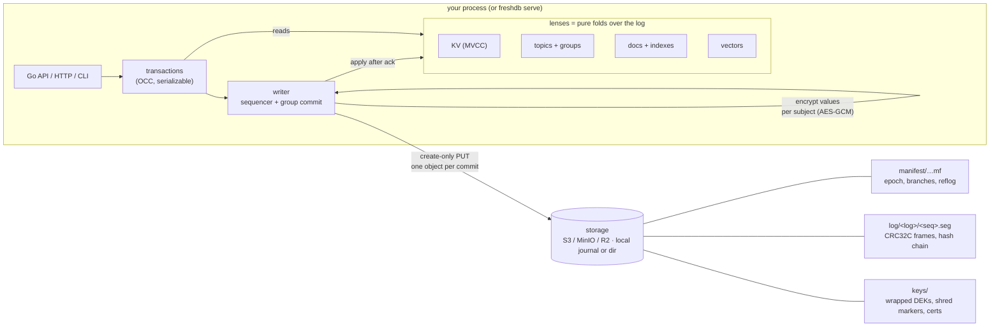

# Architecture

> Status: describes unreleased `main` (pre-1.0 prototype); v0.1.0 differences
> are noted. See [formats.md](formats.md) for byte layouts and
> [operations.md](operations.md) for running it.

## The pieces

**Store** (`store/`). The only interface to the outside world. Besides
get/list/delete and ranged reads, it has one key primitive: `PutIfAbsent`
(create-only). Implementations:
- **S3** (`s3://`): `PUT` with `If-None-Match: *`; ranged `GET` for reads.
- **Journal** (`journal://`, and the default for new local directories on
  Unix): every object is a record in one preallocated append-only file,
  `journal.fj`, indexed in memory. A create-only put is one `write` plus one
  `fdatasync`. An exclusive `flock` guards writers.
- **Files** (`fs://`, the v0.1.0 layout and the Windows default): one file per
  object, written as a temp file plus `renameat2(RENAME_NOREPLACE)` (or
  `link`), with fsync of the file and the directory.
- `mem://` for tests, and `store.Faulty`, which wraps any store to inject
  failed, lost, delayed, duplicated and torn writes for the simulator.

`store.OpenLocal` picks the local layout: an existing directory keeps its
own, and `freshdb migrate` converts offline (model-checked in
`spec/FreshMigrate.tla`; see [design 01](design/01-journal-default.md)).

**Manifest** (`manifest.go`). A small JSON document holding the writer epoch,
the logs (each with an optional parent and fork LSN), branch refs → log ids,
the reflog and declared doc indexes. Manifests are numbered densely
(`manifest/00000000000000000007.mf`) and are only ever *created*, never
overwritten. Whoever creates id N+1 owns the database from then on.

**Open and fencing** (`db.go`, `log.go`). `Open` reads the latest manifest and
creates the next one with `epoch+1`. Because the write is create-only, exactly
one concurrent opener wins. It then recovers each log it will write to:

1. List and read segments in sequence order.
2. Verify CRCs and the hash chain.
3. If the *final* segment is torn (a power-loss partial write), copy it to
   `quarantine/` and replace it with its valid prefix. Damage anywhere else is
   an error (`ErrCorrupt`): acknowledged data is never silently dropped.
4. If it sees any segment from a *newer* epoch, it stops with `ErrFenced` and
   writes nothing. TLC found this race; see [spec/RESULTS.md](../spec/RESULTS.md).
5. It writes an empty *fence* segment with its own epoch at the next sequence
   number.

From then on, an older writer (a "zombie") fails its next create-only segment
write, or sees the newer epoch, and stops with `ErrFenced`.

**Writer** (`writer.go`). There is one writer per log. Transactions run
optimistically against a snapshot, and at commit the writer validates their
read sets (OCC), which makes them serializable. Hot keys cannot starve:
transactions that already lost a conflict are validated first in the next
batch and back off with jitter, and after 3 lost conflicts the body runs on
the writer itself at the applied head, so it commits on that attempt.
Several such escalated transactions can share a batch; one that conflicts
with an earlier write in the batch moves to the next. It then assigns LSNs and
encrypts subject-tagged values. All transactions that arrive within a batch
become **one segment object** (group commit). A transaction is acknowledged
only after that object is durable. If a PUT's outcome is unknown (for example
a timeout), the writer reads the object back. If it still can't tell, it
returns `ErrUnknownOutcome` and never acks.

**Lenses** (`lens/`). KV with full version history (MVCC), topics with
consumer-group cursors, documents with secondary indexes, and vectors with
cosine search. Each is a deterministic fold over log entries; see
[lens-authoring.md](lens-authoring.md). Lens state lives in memory, with one
exception: the KV lens keeps values larger than `InlineMax` (64 B) as a
position (segment, offset, length, CRC-32C) in their immutable segment, and
reads them back on demand through the **value cache** (`vcache.go`: 64
shards of byte rings in one off-heap `mmap` arena, default 256 MiB,
`WithValueCacheBytes`). Every value read from storage is CRC-checked before
it is returned or cached, and values are copied on the way in and out.
Vectors live in one contiguous `float32` slab per collection; search is an
exact, parallel scan with a bounded top-k heap. KV and topic lenses can be
checkpointed to `snap/` (off by default), but checkpoints are an
optimisation, never the source of truth.

**Branches** (`branch.go`). A branch is a log with a parent and a fork LSN, so
creating one copies no data. Reads on a branch see the parent's entries up to
the fork LSN, then the branch's own. *Rewind* creates a new log forked from the
target LSN and moves the ref; the old head goes into the reflog, so nothing is
deleted. *Promote* points one branch name at another's log. *Time travel*
(`ViewAt`) reads any branch as of any LSN.

**Shred** (`shred.go`, `keyring.go`). Each subject gets its own data key (DEK),
stored in `keys/dek/<hash>` wrapped by the key-encryption key (KEK). Subject
names are hashed before they reach the log. `Shred(subject)` does four things,
each one crash-safe:

1. Write a shred marker.
2. Delete the DEK.
3. Append an audit `SHRED` entry to the log.
4. Return an ed25519-signed certificate (subject hash, LSN, chain head,
   manifest id).

Lenses drop the subject (`DropSubject` ≡ folding the redacted log), and
ciphertext stays in old segments. Because the hash chain covers the stored
ciphertext, it still verifies. `Verify` re-checks everything and sweeps any
DEK that landed late.

## Why one log is enough for exactly-once

A consumer group's cursor is just another key in the log. "Fetch message,
write result, advance cursor" is one serializable transaction, so it commits
entirely or not at all. There is no separate outbox and no two-phase commit.
The FreshTxn TLA+ model checks this (`ExactlyOnce`, `AtomicCursor`).

## What runs where

- **Embedded:** `freshdb.Open(ctx, url)` in your Go process. This is the fastest
  path and has no network hop.
- **Server:** `freshdb serve` exposes the same engine over JSON/HTTP. The CLI talks
  to it with `--addr`.
- **CLI without `--addr`:** opens the database itself (embedded). That takes
  the write lease and fences any running server on the same URL.
